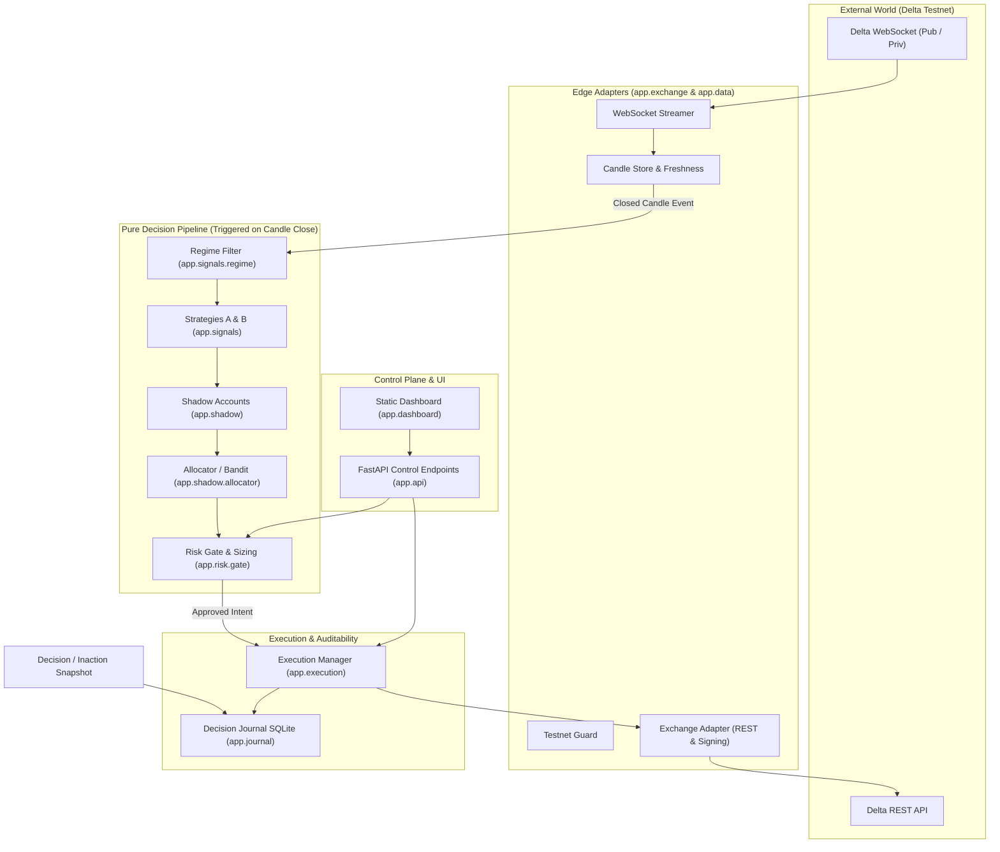

# QuantPilot System Architecture

QuantPilot is designed as a **Glass-Box Desk** — an algorithmic trading system on Delta Exchange Testnet emphasizing pure-function decision logic, deterministic auditability, and multi-layered risk management.

---

## Architecture Diagram

---

## Layer Responsibilities

1. **`app.exchange`**:
   - Strictly enforces the `TestnetGuard`.
   - Computes HMAC-SHA256 signatures with 5-second freshness checks.
   - Normalizes all exchange prices and quantities to Python `Decimal` objects.
   - Tracks the rate limit budget (20,000 weight / 5 min).

2. **`app.data`**:
   - Aggregates streaming ticks into completed candles.
   - Asserts candle continuity and emits exactly one `CandleClosedEvent` per timeframe interval.
   - Computes data staleness in milliseconds.

3. **`app.signals`** (Red Zone):
   - Pure functions mapping immutable historical candles to `Signal` contracts.
   - Evaluates regime classification (trending, ranging, chaotic).

4. **`app.shadow`** (Red Zone):
   - Virtual accounts tracking paper performance with modeled realistic transaction fees and slippage.
   - Allocator selects active strategy via Thompson sampling or regime fallback.

5. **`app.risk`** (Red Zone):
   - Single gateway evaluating hard rejections, position caps, and volatility-scaled sizing.
   - Houses the Kill Switch and watchdog routines.

6. **`app.execution`**:
   - Converts approved intents into signed orders with bracket exits.
   - Tracks idempotency via structured `client_order_id` values.
   - Reconciles exchange truth against local state.

7. **`app.journal`**:
   - SQLite persistence layer for every decision (trades and non-trades).
   - Generates deterministic, human-readable plain language narratives for why actions were taken.
